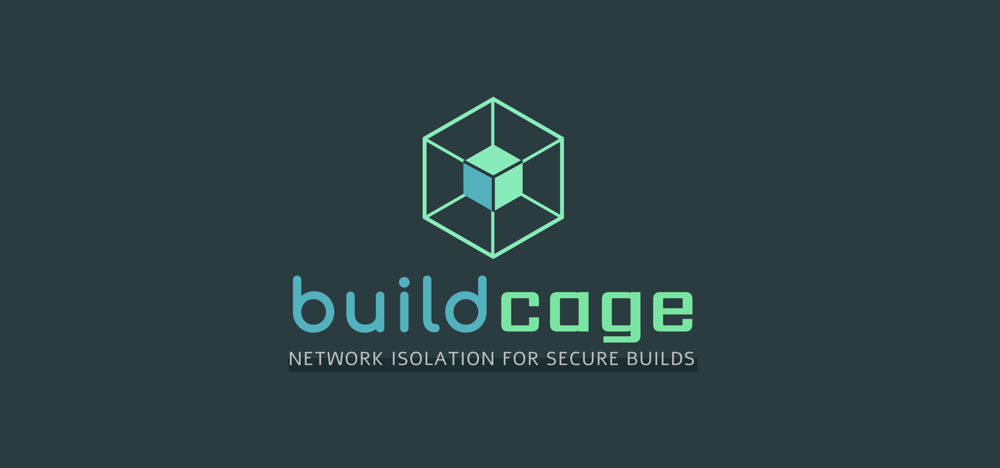
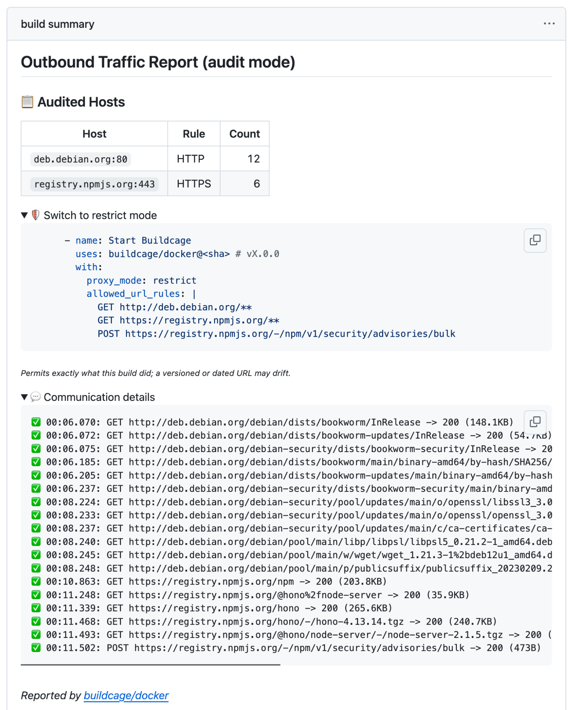
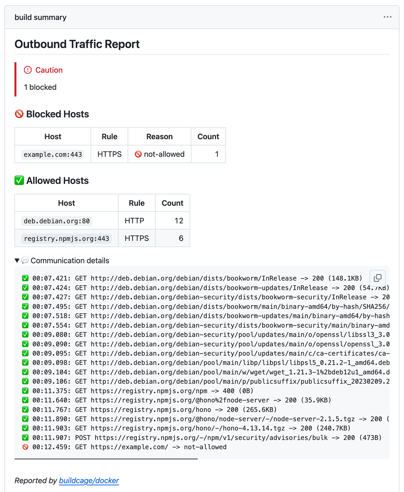
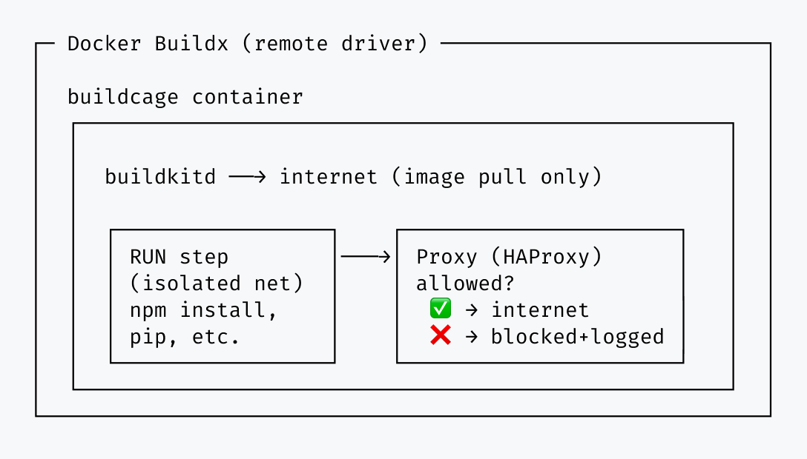

# Buildcage for Docker



[](https://github.com/buildcage/docker)
[](https://github.com/marketplace/actions/buildcage-for-docker)


A `docker build` runs your `RUN` steps, and every dependency they fetch, with unrestricted network
access. Buildcage puts that behind an allowlist: each `RUN` step can reach only the destinations you
name, and anything else is blocked and reported.

- Your Dockerfile doesn't change, BuildKit isn't patched, and nothing Buildcage does is left in the
  image layers.
- Run once in [`audit`](#operation-modes) mode and the report writes the allowlist for you, ready to
  paste back into the workflow.
- A rule can name an HTTP method and a URL, inside TLS as well, so a build can fetch a package from
  a registry without being able to publish one to it.
- It all runs inside your GitHub Actions job, with no agent and no external service.

See [buildcage.github.io](https://buildcage.github.io/) for what it does and why. To isolate a
workflow `run:` step rather than a Docker build, use
[Buildcage for `run:` Steps](https://github.com/buildcage/isolated-run).

## Contents

- [Requirements](#requirements)
- [Usage](#usage)
- [Engines](#engines)
- [Inputs](#inputs)
- [Report action](#report-action)
- [How it works](#how-it-works)
- [CA trust and compatibility](#ca-trust-and-compatibility)
- [Scope](#scope)
- [Limitations](#limitations)
- [FAQ](#faq)
- [GitHub's native egress firewall](#githubs-native-egress-firewall)
- [Documentation](#documentation)

## Requirements

The builder is a container on the runner itself, so this action needs a Linux runner with a working
Docker installation:

- **GitHub-hosted**
  - `ubuntu-latest`, the versioned `ubuntu-*` images, and their `-arm` variants
  - Lightweight images such as `ubuntu-slim` are not supported: they ship a Docker client with no
    daemon
- **Self-hosted**
  - Docker Engine 25.0 or later, with Compose v2.20.2 or later
  - A host using cgroup v2
  - For the `inspect` engine, a Docker data root that can hold an overlayfs upper directory: not
    itself on overlayfs (Docker-in-Docker needs a volume for `/var/lib/docker`) and not on XFS
    formatted with `ftype=0`

A runner that falls short fails while the builder starts, before any `RUN` step runs.

## Usage

Buildcage starts a BuildKit builder in your job. Point Docker Buildx at it as a remote driver and
build as usual. Run once in [`audit`](#operation-modes) mode to collect what the build reaches, then
switch to `restrict`. The examples below use the default `inspect` engine; [Engines](#engines)
covers the choice of engine.

### 1. Find out what the build reaches

```yaml
- name: Start Buildcage in audit mode
  uses: buildcage/docker@ef2b79a3baaddc6a69c1b10a2c473a134ece2eca # v4.4.0
  with:
    proxy-mode: audit # Log every destination, block nothing

- name: Set up Docker Buildx
  uses: docker/setup-buildx-action@f87e5991a6d7451dcb8d9637bfbc97413f497069 # v4.4.1
  with:
    driver: remote
    endpoint: docker-container://buildcage

- name: Build
  uses: docker/build-push-action@c3c9e263c25d99ce0380d002d59b67737d91b0dc # v7.4.0
  with:
    context: .

- name: Show Buildcage report
  if: always()
  uses: buildcage/docker/report@ef2b79a3baaddc6a69c1b10a2c473a134ece2eca # v4.4.0
```

The [report action](#report-action) writes every destination the build contacted to the Job Summary:



Its **Switch to restrict mode** section holds the allowlist, already written out from what the build
actually did. A request whose method, host or path a rule would read as a wildcard is listed under
it rather than written in, since copying it would permit more than was sent.

### 2. Enforce the allowlist

Paste that allowlist into the setup step and switch the mode:

```yaml
- name: Start Buildcage in restrict mode
  uses: buildcage/docker@ef2b79a3baaddc6a69c1b10a2c473a134ece2eca # v4.4.0
  with:
    proxy-mode: restrict
    allowed-url-rules: |
      GET http://deb.debian.org/**
      GET https://registry.npmjs.org/**
      POST https://registry.npmjs.org/-/npm/v1/security/advisories/bulk
```

Each rule names the methods it permits, so this one lets npm fetch packages without letting it
publish any: a `POST` to the same host is blocked, as is every host not listed.



A blocked connection fails the job at the report step, so a build that starts reaching somewhere new
doesn't pass unnoticed.

### Example workflows

Each pair runs a build in audit, then in restrict with the rules audit reported and one request they
block: `inspect` on an apt and npm build ([audit](.github/workflows/example-inspect-audit.yml) ·
[restrict](.github/workflows/example-inspect-restrict.yml)), `universal` on a Maven build
([audit](.github/workflows/example-universal-audit.yml) ·
[restrict](.github/workflows/example-universal-restrict.yml)).

## Engines

`proxy-engine` sets how closely a build's traffic is read. `inspect` is the default; `universal` has
to be set explicitly.

`inspect` terminates TLS and re-signs it with a CA generated for each builder container. Rules
match on method and URL, so `GET|HEAD https://registry.npmjs.org/**` allows a fetch while blocking a
publish on the same host, and the report names every request with its URL. The build has to trust
that CA: Buildcage adds it to the system store, to the CA-trust variables, to a JVM already in the
base image, and to Chromium's NSS database, so most toolchains need nothing extra (see [CA trust and
compatibility](#ca-trust-and-compatibility)).

`universal` reads only the SNI. Rules match on host and port, so `registry.npmjs.org:443` is the
most one can say, the report shows host and port, and the build's own TLS is left untouched.

Start with `inspect`. When a tool pins a certificate or ships a trust store Buildcage cannot inject
into, its host cannot be re-signed: switch the whole build to `universal`, or pass that host alone
through with `allowed-tls-rules`.

Every engine intercepts at the network level, so a tool that ignores `HTTP_PROXY` is covered too,
and only `RUN` steps go through it. What buildkitd fetches for itself stays outside: see
[Limitations](#limitations).

## Inputs

Every input is optional, and the ones below are the rules you write by hand. The full list, with
defaults and the engines each input applies to, is in
[Reference](./docs/reference.md#setup-action-inputs), and the grammar those rules are written in is
in [Rule syntax](./docs/reference.md#rule-syntax).

The builder is named `buildcage` unless `builder-name` says otherwise, and the Buildx `endpoint` has
to match whatever it is named. The setup action's `builder-name` output holds the name it used.

The inputs can also live in a YAML file next to the Dockerfile, named by `config-file`. See
[Config file](./docs/reference.md#config-file).

A `#` starts a comment at the start of a line or after whitespace, so a group of rules can carry a
heading or a rule can carry its reason. It works the same in every rule input.

### Operation modes

`proxy-mode: audit` logs every destination the build reaches and blocks nothing. `restrict`, the
default, allows only what the rules match and blocks and logs everything else. Start with `audit`
when you first adopt Buildcage or when a dependency changes, and keep `restrict` for everyday
builds.

If you forget a domain the build needs, `restrict` blocks it and the report step fails with the
destination named, which is why it is worth running `audit` first.

`audit` also lets through a connection made straight to an address. Under `universal` that includes
cloud metadata (`169.254.169.254`) and the runner's own addresses; `inspect` still blocks those
unless a rule names the address as its host.

### Rules for the `inspect` engine

`allowed-url-rules` is the one to reach for. Each line is a method list, a space, and a URL pattern.
`*` stays inside one domain label or path segment, `**` crosses dots and slashes, and a rule with no
path allows any path on that host:

```yaml
allowed-url-rules: |
  # apt
  GET http://deb.debian.org/**

  # npm: fetch packages, and the audit endpoint it posts to
  GET https://registry.npmjs.org/**
  POST https://registry.npmjs.org/-/npm/v1/security/advisories/bulk

  # pip: one registry, two domains
  GET https://pypi.org/simple/**
  GET https://files.pythonhosted.org/packages/**

  # a private registry is an ordinary host
  GET|HEAD https://registry.internal.example.com:8443/**
```

`allowed-tls-rules` passes a TLS destination through undecrypted, judged on its SNI and port. It is
for TLS that isn't HTTPS, and for the hosts an `inspect` build must not decrypt:

```yaml
allowed-tls-rules: |
  db.example.com:5432
  repo.maven.apache.org:443
```

`allowed-ip-rules` covers connections made straight to an address, which never go through DNS. A
rule may be an address, a CIDR block or a wildcard, on every engine:

```yaml
allowed-ip-rules: |
  192.168.1.10:443
  10.0.0.0/8:443
```

### Rules for the `universal` engine

`universal` never decrypts, so rules name a host and a port. `allowed-https-rules` and
`allowed-http-rules` split by scheme, and `allowed-ip-rules` works as it does under `inspect`:

```yaml
allowed-https-rules: |
  # npm and maven
  registry.npmjs.org:443
  repo.maven.apache.org:443
  *.internal.example.com:443  # every host one level under internal.example.com

allowed-http-rules: |
  deb.debian.org:80

allowed-ip-rules: |
  192.168.1.10:443
```

### Destinations you expect to stay blocked

A noisy dependency, or a domain you are deliberately keeping off the allowlist to confirm it stays
blocked, belongs in `known-blocked-rules`. Their rows move to the report's collapsed **Known Blocked
Hosts** and do not fail the job; the destination stays unreachable:

```yaml
known-blocked-rules: |
  telemetry.example.com
```

A name blocked at resolution, before any connection, has no port. A bare `telemetry.example.com`
(or `telemetry.example.com:*`) covers it; `telemetry.example.com:443` does not, since no port was
involved.

One rule per line, and on `inspect` a line can also be a URL rule (a method and a URL, the
`allowed-url-rules` syntax) to acknowledge a single endpoint on a host whose other traffic is
allowed, such as a telemetry POST to an API you otherwise use:

```yaml
known-blocked-rules: |
  POST https://api.example.com/telemetry
```

Any other blocked request to that host still fails the step. See
[Blocked rules](./docs/reference.md#blocked-rules-known-blocked-rules) for the full syntax.

## Report action

`buildcage/docker/report` reads the builder's communication log and writes the Job Summary. Add it
with `if: always()` so a failing build still reports:

```yaml
- name: Show Buildcage report
  if: always()
  uses: buildcage/docker/report@ef2b79a3baaddc6a69c1b10a2c473a134ece2eca # v4.4.0
```

An alert under the report's title counts what needs a look. Whatever was blocked unexpectedly is
listed first with the reason, together with any connection that failed, then the allowed hosts, then
what `known-blocked-rules` matched, collapsed under **Known Blocked Hosts**. Under `inspect`,
**Communication details** names the URL of every request, allowed or blocked, with credential query
parameters replaced (see [Credentials in a URL](docs/security.md#credentials-in-a-url)). In `audit`
mode the summary also holds the **Switch to restrict mode** allowlist. How the alert and the tables
are made up is in [Report details](./docs/reference.md#report-details).

In `restrict` mode the step fails when a blocked connection is found, and with it the workflow. Pass
`fail-on-blocked: false` to report without failing, or list what you expect to stay blocked in the
setup action's `known-blocked-rules`. In `audit` mode nothing fails the step. The action's inputs
are in [Reference](./docs/reference.md#report-action-inputs).

### Traffic artifact

`upload-traffic-artifact: true` uploads the whole timeline as a `traffic.json`, one row per request
and per name lookup, with the method, URL, status, size and the address it resolved to. It is
uploaded even when the build fails. Under `universal` it omits the method, URL, status and resolved
address that only `inspect` sees. The fields are listed in
[Reference](./docs/reference.md#traffic-artifact).

## How it works



BuildKit itself is unpatched. Buildcage starts it with a network configuration that puts every
`RUN` step on its own network, and wraps its runtime so the build CA is mounted into a step for as
long as that step runs. Name lookups and traffic from there reach the resolver and the proxy in the
builder container, at the network level, so a tool that ignores the proxy environment variables is
covered as well. The figure is the `inspect` engine; `universal` follows the same path without
terminating TLS, and so needs no CA.

Buildx needs `driver: remote` because the builder is a second BuildKit, but multi-stage builds,
caching and the image that comes out are unaffected, and nothing Buildcage does reaches the LLB or a
cache key.

[Security Details](./docs/security.md) has the architecture of each engine, with a diagram of what
runs where and what it decides.

## CA trust and compatibility

`proxy-engine: inspect` terminates TLS and re-signs it with a CA generated for each builder
container, whose private key never leaves that container
([details](docs/security.md#the-ca-and-its-private-key)), so the build has to trust that CA. As each
`RUN` step starts, Buildcage adds it where the common toolchains look:

- The system CA store, including the distribution's anchor directory, so a step that installs
  `ca-certificates` partway through keeps trusting it.
- The variables Node, Deno, OpenSSL, Python `requests` and pip read: `NODE_EXTRA_CA_CERTS`,
  `DENO_CERT`, `SSL_CERT_FILE`, `REQUESTS_CA_BUNDLE` and `PIP_CERT`, and `CURL_CA_BUNDLE` in a step
  with no system CA store. A variable the base image or the Dockerfile already set is appended to
  rather than redirected, and so are `GIT_SSL_CAINFO`, `npm_config_cafile`, `AWS_CA_BUNDLE`,
  `CARGO_HTTP_CAINFO` and `BUNDLE_SSL_CA_CERT`, which are otherwise left unset.
- The keystore of a JVM already in the base image, at `$JAVA_HOME` and behind the first `java` on
  `PATH`, so `mvn`, `gradle` and `java` reach the proxy without `proxy-engine: universal`.
- The NSS database in `$HOME` that Chromium reads, including the `chrome-headless-shell` that
  Puppeteer, Playwright and Remotion download.

All of it is taken back out before the layer is committed, so neither the CA nor the variables are
left in the image, except a copy a step hides where it cannot be read, or one it cannot take out
under `fail-on-ca-residue: false`. How each one is done is in
[CA trust variables](./docs/reference.md#ca-trust-variables), and what this cannot cover is in
[Limitations](#under-the-inspect-engine), below.

## Scope

Buildcage controls _where_ your build can connect, not _what code_ it runs. A malicious package
delivered through an allowed domain still runs. Treat it as one layer among your other measures: if
something gets past them, it still cannot reach a destination outside the allowlist.

An allowlist also cannot stop anything leaving through a service you had to allow anyway. What it
does stop is traffic to a destination that is not on the list, and infrastructure an attacker set
up is normally not on it, because the build has no reason to reach it. That is also the hardest kind
of leak to find afterwards.

An allowlist generated from an audit run already blocks every destination the audit did not record.
Whether to go further depends on what the build has access to:
[Hardening](./docs/security.md#hardening) is what to look at when it holds credentials, personal
data, or source you do not publish. For the full threat model, see
[Security Details](./docs/security.md).

## Limitations

### What isn't covered

- buildkitd's own traffic is outside the allowlist. `FROM`, `ADD <url>`, git contexts and the
  frontend image a `# syntax=` directive names are fetched by buildkitd itself rather than by a
  `RUN` step, and no rule applies to them.
  See [What buildkitd fetches itself](./docs/security.md#what-buildkitd-fetches-itself).
- `allowed-tls-rules` is not decrypted. The SNI and the port are checked, and the proxy resolves
  that name itself, so the connection reaches the host the rule named, but nothing inside the TLS
  session is seen.
- `allowed-ip-rules` is not inspected at all, and doesn't require TLS either: once an `ip:port` pair
  is allowed, any TCP-based protocol can use that path. Prefer a domain rule wherever the
  destination has a stable name.
- `universal` never sees the method or the path. They travel inside TLS, so neither is enforced and
  neither reaches the report or the traffic artifact. A request fronted behind an allowed SNI is
  invisible to it as well, while `inspect` matches on the real `Host` and blocks it. See
  [Domain fronting](./docs/security.md#domain-fronting).
- An allowlisted name that resolves to cloud metadata, to loopback, or to an address the runner
  itself holds is blocked, so a compromised name cannot turn the proxy into a route back into the
  runner. A mirror or registry running on the runner is therefore not reachable by name: allow it
  with `allowed-ip-rules`, which skips that guard except for the proxy's own port. See
  [A name may not resolve inward](./docs/security.md#a-name-may-not-resolve-inward).
- The generated allowlist covers only what the engine classified. `allowed-tls-rules` and
  `allowed-ip-rules` come back exactly as the audit run was configured with them, since nothing
  behind a passthrough was ever decrypted.
- Buildcage produces no SLSA provenance. The traffic artifact is an observation record with no
  content digest.

### Protocols

- UDP is dropped, so QUIC and HTTP/3 either fall back to TCP or fail. Port 53 to the proxy, which is
  the resolver, is the one exception. ICMP is dropped too.
- IPv6 is not used anywhere. The rule syntax refuses an IPv6 address, forwarded IPv6 is dropped, and
  the proxy reaches allowed names over IPv4 only, so an allowed name with AAAA records and no A
  record never resolves and no rule can clear it.

### Service discovery

The resolver has no upstream, so it returns nothing for a discovery record: `SRV`, `TXT`, `TLSA` and
`URI` queries come back empty, and the build connects to the name a rule allowed rather than to one
a nameserver picked for it. Clients that treat `SRV` as a discovery layer fall back to the host name
itself, so the host a rule names is the host the build reaches.

What this breaks is a client with no fallback, where the record is the only way it can find the
service at all. A `mongodb+srv://` connection string is the one to expect: use `mongodb://` with the
shard hostnames written out and allowlist those instead. Active Directory and Kerberos discovery
have the same shape.

Under `inspect`, a lookup for a `_service._proto.<host>` name is reported as `discovery` when the
rules allow that host, and is not counted as blocked. A service name under any other host is
reported as blocked; see
[Blocked service names](./docs/reference.md#blocked-service-names).

### Under the `inspect` engine

- A tool that pins a specific certificate, or ships a bundled trust store it never lets the system
  update, still needs `proxy-engine: universal` or an `allowed-tls-rules` passthrough: `inspect`
  re-signs the connection, and a pinned or bundled store will not accept the new certificate.
- A client that insists on HTTP/2 through ALPN, as gRPC clients do (grpc-go since 1.67, for one),
  fails to connect: `inspect` answers no ALPN. Pass its host through with `allowed-tls-rules`,
  which judges the SNI and port only. A client that falls back to HTTP/1.1, such as curl, works.
- Only the JDK at `$JAVA_HOME` and the one behind the first `java` on `PATH` get the CA in their
  keystore. A keystore sealed with a password other than the JDK default is left alone, so that JDK
  needs `proxy-engine: universal` or an `allowed-tls-rules` passthrough. Any other JDK does not
  trust the CA: one further along `PATH`, a Gradle toolchain under `~/.gradle/jdks`, or one the step
  itself downloads (an `sdk install`, an unpacked tarball). Fetch it in an earlier `RUN` step and
  put it first on `PATH` or on `JAVA_HOME` with `ENV`:

  ```dockerfile
  RUN tar xzf jdk-21.tar.gz -C /opt/java && /opt/java/jdk-21/bin/java -jar fetch.jar   # fails
  RUN tar xzf jdk-21.tar.gz -C /opt/java
  ENV PATH=/opt/java/jdk-21/bin:$PATH
  RUN java -jar fetch.jar                                                              # fine
  ```

- Chromium trusts the CA only through the NSS database under the `HOME` the step starts with.
  Chromium started with another `HOME` (`HOME=/tmp chromium`) or as another user (`su`, `gosu`,
  `sudo -u`) does not trust it: switch users with `USER` and leave `HOME` alone within the step. A
  Chromium before M146 reads only `~/.pki/nssdb`. A database the step's user cannot write takes no
  slot, and the step warns; use `proxy-engine: universal` for Chromium there. See
  [Chromium](./docs/reference.md#chromium).
- A Firefox carrying Mozilla's own root list, such as Playwright's or the one Selenium drives, reads
  a per-profile database and does not trust the CA; use `proxy-engine: universal` or an
  `allowed-tls-rules` passthrough for it.
- Every `RUN` step has the NSS database's directory as a mount point, created if the home has none,
  so `rm -rf ~/.pki`, `git clone <url> .` into the home and `rm -rf ~/.[!.]*` fail; use a `WORKDIR`
  outside the home. A step that changes the CA's own trust with `certutil -M` fails the build.
- A `RUN` step that copies the system CA bundle into a binary or an uncompressed archive
  (`go:embed`, `include_str!`, `tar cf`) fails: the copy carries the build's CA, which cannot be cut
  out of a binary without corrupting it. Copy the bundle in an earlier `RUN` step instead:

  ```dockerfile
  RUN cp /etc/ssl/certs/ca-certificates.crt ./certs/ && go build   # fails
  RUN cp /etc/ssl/certs/ca-certificates.crt ./certs/
  RUN go build                                                      # fine
  ```

- A copy of the CA left in a step's layer is removed. One that cannot be, such as in a JKS keystore
  sealed with a password other than `changeit`, fails the build (`fail-on-ca-residue: false` makes
  it a warning). One that cannot be read, such as in a compressed archive, is not found and stays in
  the image. See [CA residue](./docs/reference.md#ca-residue).
- `audit` terminates TLS as well. It drops the rules, not the interception, so a tool that cannot
  accept the CA fails in `audit` exactly as it would in `restrict`.
- An image with no system CA store (`scratch`, distroless, or `debian:*-slim` before
  `ca-certificates` is installed) still gets every variable set, but pointed at a file trusting only
  the proxy's own CA. That is enough for ordinary HTTPS, since `inspect` re-signs all of it with
  that CA, but not for an `allowed-tls-rules` or `allowed-ip-rules` passthrough, which presents its
  own real certificate. The decision is made once, from the rootfs as the step begins, so installing
  `ca-certificates` partway through a step doesn't help a passthrough made later in the same step:

  ```dockerfile
  RUN apt-get install -y ca-certificates && \
      curl https://internal.example.com/pkg.tgz -o pkg.tgz   # still fails: CURL_CA_BUNDLE was already
                                                             # fixed to the proxy-CA-only fallback

  RUN apt-get install -y ca-certificates
  RUN curl https://internal.example.com/pkg.tgz -o pkg.tgz   # this step starts with a store, so
                                                             # CURL_CA_BUNDLE points at it instead
  ```

- A task runner that starts each command with a filtered environment drops the CA variables before
  the command sees them. vite-plus does this for a cached `vp run` task, which keeps `NODE_OPTIONS`
  but not `NODE_EXTRA_CA_CERTS`, so Node inside it fails with `SELF_SIGNED_CERT_IN_CHAIN`. In an
  image with a system CA store, which holds the CA already, have Node read that store. As an `ARG`
  the flag reaches every later `RUN` in the stage without staying in the image, unless an
  `ENV NODE_OPTIONS` overrides it:

  ```dockerfile
  ARG NODE_OPTIONS=--use-system-ca   # Node 22.15+ (23.9+ on 23.x); older Node refuses to start
  RUN vp run build
  ```

  Otherwise pass the variable through on the task itself, as `untrackedEnv` rather than `env`, which
  would put its value in the cache key. A task with `cache: false` keeps the whole environment.

  ```ts
  // vite.config.ts
  build: { command: "vp build", untrackedEnv: ["NODE_EXTRA_CA_CERTS"] },
  ```

- The directories holding a bundle or keystore the CA is added to are mounted over while the step
  runs. Removing or renaming one fails, while what is inside it behaves normally:

  ```dockerfile
  RUN rm -rf /etc/ssl/certs        # fails: the directory is a mount point
  RUN rm -rf /etc/ssl/certs/*      # fine
  ```

  A JDK with a keystore of its own has its `lib/security` mounted, so take it off `PATH` and
  `JAVA_HOME` with `ENV` before a step removes it. See
  [Mounted directories](./docs/reference.md#mounted-directories).

## FAQ

**A host only ever gets looked up, never connected to. How do I write a rule for it?**

The report gives it a row with `DNS` as the rule kind and no port. If you want it to stay
unreachable without failing the job, put the name in `known-blocked-rules`, which is the one input
where a host rule may omit the port. If the build actually needs it, write an ordinary host or URL
rule and the lookup is reported as allowed.

**Why not use BuildKit's built-in `--proxy-network`?**

BuildKit's exec network proxy injects `HTTP_PROXY`/`HTTPS_PROXY` into each `RUN` step and can record
what it fetched as SLSA provenance, which Buildcage does not do. Two limits kept it from being the
enforcement mechanism. Its source policy matches a request's host, port and URL path but has no
notion of an HTTP method, so it cannot allow a fetch from a registry while blocking a publish to the
same host, which `inspect` does by terminating TLS. And because it is an explicit proxy, what it
enforces and records reaches only tools that honor the proxy variables; a tool that ignores them is
not covered. Buildcage enforces at the network level instead, so it also covers those tools and can
act on the method and URL.

**Can I trust the action itself?**

Buildcage relies on being verifiable rather than on being trusted. The source is open for anyone to
read at any time, and the action runs only what was built from it: each release is immutable, its
image is built from the release commit and signed, and the action verifies that before it runs.
Changing what Buildcage does means changing its public source first. See
[Image provenance verification](./docs/security.md#image-provenance-verification).

## GitHub's native egress firewall

GitHub is building an egress firewall directly into Actions runners
([technical preview](https://github.com/github-early-access/actions-native-egress-firewall) as of
September 2026): opt a job into a firewall-enabled runner image and its traffic is inspected outside
the runner VM, in `log` or `enforce` mode, from a single `.github/egress-firewall.yaml` in the
repository. Because it sits outside the VM, a workflow that gains root inside the runner cannot
switch it off. Firewall-enabled images are GitHub-hosted and Linux only.

One policy for the whole run is one allowlist for every step in it: the destinations
`actions/checkout`, the caches and the setup actions need stay open to the build as well. Buildcage
writes a separate allowlist for the build you don't trust, so a `docker build` gets the hosts that
build needs and nothing else, and a rule there can name a method and a URL rather than only a host.
The two compose: a perimeter the job can't switch off, and a tighter policy inside it.

Buildcage also runs on any Linux runner with Docker, self-hosted included, rather than on a
firewall-enabled runner image.

## Documentation

| Doc                                        | What's in it                                                        |
| ------------------------------------------ | ------------------------------------------------------------------- |
| [Reference](./docs/reference.md)           | Every input, the rule syntax in full, and the report's own output   |
| [Security Details](./docs/security.md)     | Architecture and threat model for every engine, attack resistance   |
| [Development Guide](./docs/development.md) | Working on Buildcage itself: setup, local runs, tests and the rules |

## Contributing

Contributions are welcome! Please feel free to submit issues or pull requests at [github.com/buildcage/docker](https://github.com/buildcage/docker).

## Show Your Support

Knowing that this project is useful to others gives me the motivation to keep working on it.
If you find Buildcage helpful, please consider giving it a star ⭐ on GitHub!

## Disclaimer

This software is provided "as is", without warranty of any kind, express or implied. The authors and contributors are not liable for any damages, losses, or security incidents arising from the use of this software. Use at your own risk.

## License

The Buildcage source code is licensed under the MIT License. See [LICENSE](./LICENSE) file for details.

The Docker image includes third-party components under their own licenses (GPL, Apache 2.0, ISC, etc.). See [THIRD_PARTY_LICENSES](./THIRD_PARTY_LICENSES) for the full list. The image carries that file, this repository's LICENSE and the license texts it points to under `/opt/buildcage/`.

The Actions bundle their npm dependencies (MIT, Apache 2.0, ISC) into the committed `dist/` files. See [THIRD_PARTY_LICENSES_NPM](./THIRD_PARTY_LICENSES_NPM) for their license texts.
