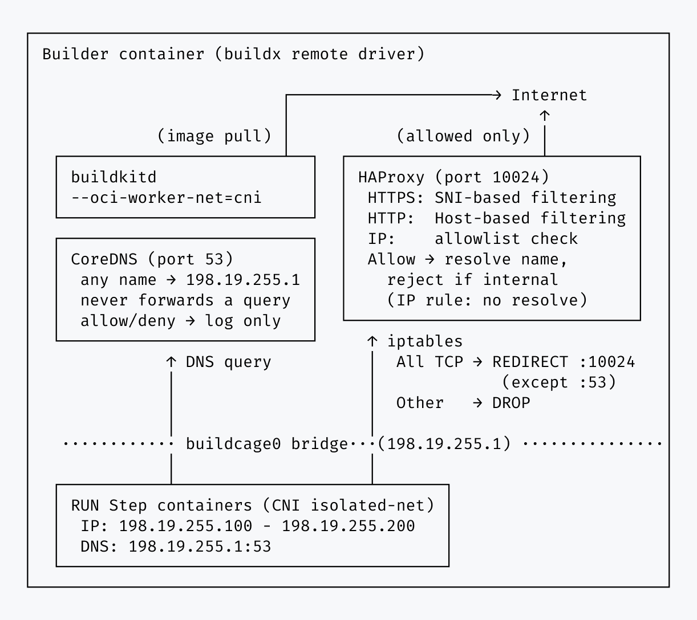
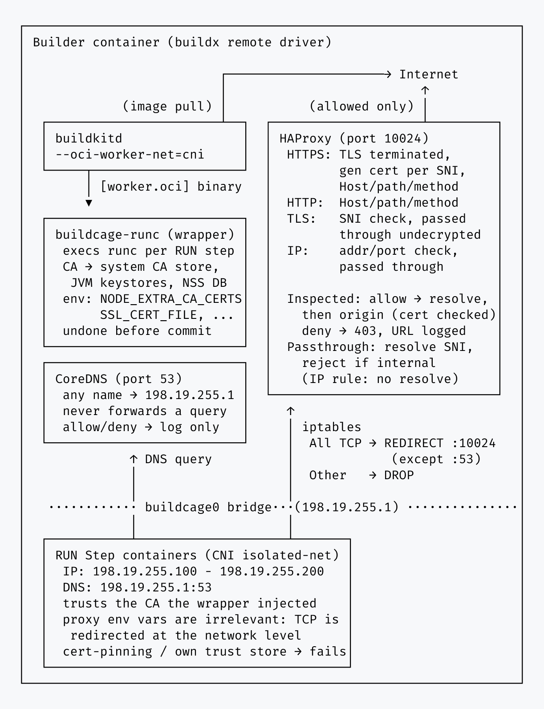

# Security Details

This document is the threat model behind Buildcage: what it governs, how a build is kept to its
allowlist, and where it stops short. For how to configure the action, see the
[README](../README.md); for working on Buildcage itself, see the
[Development Guide](./development.md). For a high-level overview, see
[buildcage.github.io](https://buildcage.github.io/).

## Contents

- [Threat model](#threat-model)
- [Attempts to get around it](#attempts-to-get-around-it)
- [The network boundary](#the-network-boundary)
- [What the builder container runs with](#what-the-builder-container-runs-with)
- [Engines](#engines)
- [Known limits](#known-limits)
- [Hardening](#hardening)
- [Image provenance verification](#image-provenance-verification)

## Threat model

Buildcage governs the code that runs inside a `RUN` step: a dependency's `postinstall`, a build
script, a compiler plugin, which the Dockerfile author usually has not reviewed. It decides which
destinations that code can reach, and records what it tried.

Four things sit outside that model by design.

- **Whoever writes the Dockerfile and the workflow.** The allowlist is configured alongside them, by
  the same people, so Buildcage is not a control against them. A `config-file` is no different. On
  `pull_request_target`, and `workflow_run` triggered by a pull request, the workspace may hold the
  pull request's own code, so `config-file` is refused there. On other events it is read from
  whatever the workflow checked out, so whoever can write that copy sets the rules.
- **What buildkitd fetches for itself**, [below](#what-buildkitd-fetches-itself).
- **What a step reads.** Buildcage restricts where a `RUN` step can send data, not what it can read:
  a secret mounted with `RUN --mount=type=secret`, a build argument and the build context are all
  the step's to read. It cannot send them to a destination outside the allowlist.
- **Another step in the same job.** An untrusted step that runs between `setup` and `report` can
  rewrite the traffic log. It can reach the builder container, where the proxy runs, through
  `docker exec` or `docker cp`, and on a runner with passwordless sudo it can reach the host
  filesystem directly. `report` marks a log as incomplete when it does not start where a real proxy
  run would, and fails the step for that under `restrict` with `fail-on-blocked`. This catches a log
  erased wholesale, but not a forgery written in the log's own format. A proxy or resolver that is
  kept down, or hung, fails the step whatever the mode, and one that restarts, as after a plain
  kill, marks the report incomplete. The defense here is procedural: don't place an untrusted step
  between `setup` and `report`.

One gap does sit inside the model. The report action reads `config-file` again after the build. If
the build's `--output type=local` export writes over that file, a `RUN` step controls its contents
and can set any report input the workflow leaves unset, `fail-on-blocked: false` among them. Set
those inputs in the workflow, or keep the export away from the file (see [Config
file](./reference.md#config-file)).

An allowlist also has a limit that no rule set fixes. It decides destinations, so it cannot tell a
legitimate use of an allowed destination from an abusive one, and anything leaving through a
service you had to allow anyway still leaves. What it does stop is traffic to a destination that is
not on the list, and infrastructure an attacker set up is normally not on it, because the build has
no reason to reach it. That kind of leak is also the hardest to find afterwards.
[Hardening](#hardening) is about making the set of destinations a build needs smaller.

## Attempts to get around it

| What the build does                                                                                | What happens                                                                                                                                                 |
| -------------------------------------------------------------------------------------------------- | ------------------------------------------------------------------------------------------------------------------------------------------------------------ |
| Asks for any name, on or off the allowlist                                                         | Answered locally with the proxy's own address; the query is never forwarded, allowed or not                                                                  |
| Requests a host no rule covers                                                                     | Blocked, origin never contacted; `inspect` records the URL it asked for                                                                                      |
| Requests a path or method no rule covers                                                           | **403** under `inspect`, recorded with its URL; `universal` reads neither and enforces on the host                                                           |
| Walks out of an allowed path with `..` or `%2e%2e`                                                 | **403**: the path is normalized before the rules see it, and a `..` joined to an encoded separator or `;` is blocked, as is any backslash                    |
| Sends an allowed name while aiming elsewhere, or points `/etc/hosts` at an address of its choosing | Reaches the address the proxy resolved; the build's own choice of address is discarded                                                                       |
| Puts an address in the `Host` header                                                               | Taken as the destination once a rule allows it; an internal one only under `inspect`, and only if a rule names it as its host                                |
| Uses an allowlisted name that resolves to an internal address                                      | Blocked if it lands on loopback, link-local, the proxy itself, an address the runner holds, or another never-public range, in `audit` too                    |
| Reaches an allowed host presenting a wrong certificate                                             | **503** under `inspect`, which checks the origin's certificate when it connects and fails the step; under `universal` the build validates it itself          |
| Presents a wrong certificate and then stops answering, to look like an outage                      | Still fails the step: a connection `inspect` never completed is one whose origin it never authenticated, so it is blocked even if no error was logged        |
| Uses ECH to conceal the real SNI                                                                   | Reaches whatever the outer SNI resolved to, and that outer name still has to be allowed; the type 65 record carrying ECHConfig is never returned either      |
| Encodes data into DNS queries                                                                      | Answered locally and never forwarded; an outside resolver is unreachable                                                                                     |
| Uses DNS over TLS or DNS over HTTPS                                                                | Redirected to the proxy like any other TCP and checked on its SNI, so an outside resolver is reachable only if its own host and port are allowlisted         |
| Tunnels over ICMP, raw UDP or QUIC, or falls back to IPv6                                          | Dropped before the proxy; only TCP is redirected to it, and the proxy reaches allowed names over IPv4                                                        |
| Connects to a raw address                                                                          | Checked against `allowed-ip-rules`, and blocked when nothing matches                                                                                         |
| Speaks something that is not HTTP to a port no rule covers                                         | Parsed as an HTTP request, which fails, so it is blocked and counted like any other blocked request                                                          |
| Ignores the proxy variables entirely                                                               | No effect: interception is at the network level, not opt-in                                                                                                  |
| Sends `*` as its method, `Host` or path in audit, to plant a wildcard in the suggested rules       | Left out of the suggested `allowed-url-rules` and listed beside it, so pasting them never permits more than the build sent                                   |
| Floods the proxy log until earlier entries rotate away                                             | A log that no longer starts where a real run does is not accepted as a complete record: the step fails under `restrict` with `fail-on-blocked` (the default) |

## The network boundary

Every engine shares the arrangement below; the engines differ only in how much of a connection they
can read.

### Every RUN step runs on its own network

Each container BuildKit spawns for a `RUN` step is placed on an isolated CNI network (the
`buildcage0` bridge, 198.19.255.0/24). An iptables `PREROUTING REDIRECT` rule sends all TCP from that
bridge to the proxy whatever its destination, so DNS-resolved and direct-IP connections both arrive
there, and a `FORWARD` rule drops everything else, so no other protocol has a way out and
buildkitd's own API is unreachable from a step. An `INPUT` rule likewise restricts the proxy's
listening port to that same bridge. Steps cannot reach one another across it either: the bridge
isolates each step's bridge port, whether or not the host passes bridged traffic through iptables.

### The proxy chooses the destination, not the build

A rule matches on the name the request carried, the SNI or the `Host` header. Once it has passed,
the proxy resolves that name itself and rewrites the destination to the result (`do-resolve` and
`set-dst`), so the address the build chose is discarded. A forged `Host`, a doctored `/etc/hosts`,
or an SNI naming one host while the connection aims at another all reach the server the name belongs
to, so a spoofed destination has no effect. A connection an `allowed-ip-rules` entry covers is the
one exception: that rule names the address itself, so the connection goes there whatever name it
carries.

The rules decide before anything is resolved, so a request no rule allows never triggers a real
DNS query. Resolving first would turn resolution into the exfiltration channel that the resolver
below exists to prevent.

A `:` in a name could let a `~` rule's port pattern match a name the proxy resolves, so a name with
anything but letters, digits, `.`, `_` and `-` in it never reaches a rule, in `audit` too.
`universal` blocks such an SNI (`invalid-sni`) or plaintext `Host` (`invalid-host`). `inspect`
blocks such a `Host` (`invalid-host`), and never passes such an SNI through an `allowed-tls-rules`
entry.

The proxy resolves names through the builder container's own `/etc/resolv.conf`. On a runner that is
Docker's embedded DNS forwarding to the runner's own resolvers, so a name only an internal resolver
knows still resolves, and the query follows the runner's own DNS policy. There is no search-domain
expansion, so a rule has to name a host in full.

### A lookup alone never leaves the job

The resolver inside the cage has no upstream at all, and answers every `A` query, on the allowlist
or not, with the proxy's own address; any other type gets no records. A lookup by itself therefore
cannot carry anything out: `SECRET-DATA.attacker.example` would otherwise reach an attacker's own
nameserver the moment it was forwarded. Answering a name outside the allowlist the same way as one
inside is deliberate too, so that the request which follows reaches the proxy and is recorded, under
`inspect` with its URL, before it is blocked.

The proxy's own lookups do reach a nameserver outside the job: once the rules admit a request, the
proxy resolves the name it carried. Under `*.example.com`, a name like `<data>.example.com` is
resolved the moment a request for it is allowed, so its labels reach that domain's authoritative
nameserver. Under `inspect`, a rule's path and method are part of that decision, so a request
blocked on its path is not resolved. In `audit`, where nothing is blocked, every name the build asks
for is resolved this way. A literal host, or a narrow wildcard, limits which names leave the job;
see [Rule syntax](./reference.md#rule-syntax).

DNS has no notion of a path, so the local answer to a name under an allowed `*.example.com`
is logged as allowed before any path is known. Only the log line reflects that: the request that
follows is still checked, and one its path does not allow never reaches an origin.

No discovery record is returned either. Having no upstream, the resolver has nothing to answer an
`SRV`, `TXT`, `TLSA` or `URI` query with. This matters: `_http._tcp.deb.debian.org` carries an
`SRV` record pointing at `debian.map.fastlydns.net`, and a build that followed it would connect to a
name no allowlist mentions. A client that cannot fall back, such as a `mongodb+srv://` connection
string, does not work inside the cage; see [Service discovery](../README.md#service-discovery).

### A name may not resolve inward

An allowlisted name that resolves to loopback, link-local (AWS/GCP/Azure IMDS), CGNAT (Alibaba
IMDS), the IETF protocol block (Oracle IMDS), Azure's WireServer (`168.63.129.16`), the proxy's own
network (`198.19.255.0/24`, where the build's RUN steps also sit), or **an address the runner
itself holds** is blocked, reported as `internal-address`, in `audit` too. A name under an
attacker's control, or DNS for an allowlisted domain that has been compromised, therefore cannot
turn the proxy into a route to cloud metadata or back into the runner. The rest of RFC1918 is
deliberately exempt: a name pointing at an internal mirror is a real, intended setup.

Every address the runner holds is on the list because a published container port is DNAT'd and so
answers on all of them. The runner's addresses come from two places, because neither sees all of
them: the action reads the runner's interfaces before starting the builder, and the engine adds the
gateway of the network Docker then put it on, which did not exist when the action looked. The engine
also adds the builder's own address on that network, which Docker's DNS returns for the builder's
service and container names, so a request naming them cannot loop the proxy into itself.

This has two consequences:

- **An internal mirror running on the runner itself is not reachable by name.** Name it with
  `allowed-ip-rules` instead, which skips this guard. The same applies to a public name that
  resolves to the runner's own public address, which a self-hosted runner may well have.
- **The list is fixed at startup.** An address the runner gains later is not on it. On a
  containerized runner the list holds that container's addresses, not the real host's, so the
  host's own addresses are blocked only where they fall in one of the ranges above.

This guard is about a _name_ landing somewhere it never should. Under `inspect`, a rule whose host
is a literal address, such as `169.254.169.254:80`, exempts the requests it matches from this guard,
in `audit` too. A wildcard or regex that merely admits the address, such as `**:80` or
`~^.*:80$`, does not. The exemption never covers the proxy's own network (`198.19.255.0/24`) or
port `10024` of any internal address, since a rule naming the proxy's listener would loop it into
itself. Under `universal`, no rule exempts a request.

Reaching a cloud metadata endpoint directly, the way AWS and GCP SDKs do, is not what this is
meant to stop, and `allowed-ip-rules` is the intended path for it. A connection an IP rule covers
skips this guard, with one exception: a connection to port `10024` of an internal address is
blocked whatever the IP rules say, in `audit` too.

### Only TCP gets out

Everything that is not TCP is dropped before it reaches the proxy, so ICMP, raw UDP and QUIC have no
exit path; port 53 to the gateway, which is the resolver, is the one exception. IPv6 is
dropped the same way, AAAA lookups are answered with no records, and the proxy
reaches allowed names over IPv4 only, so a name with no A record never resolves (see
[Protocols](../README.md#protocols)).

## What the builder container runs with

A builder has to mount, create namespaces and manage cgroups, which is why the builder
`docker/setup-buildx-action` starts runs `--privileged`. Buildcage's does not. Compared with a
`--privileged` container it is narrower on every point below except AppArmor, which is unconfined
in both. Compared with a container started with no options, it adds three capabilities, allows
`pivot_root` and three `keyctl` operations, makes its own cgroup tree writable, and runs without
AppArmor.

- **`SYS_ADMIN`, `NET_ADMIN` and `SYS_PTRACE`, on top of Docker's default set.** The BuildKit OCI
  worker mounts, creates namespaces and manages a cgroup for each `RUN` step. `NET_ADMIN` covers
  iptables and the CNI bridge. runc reads `/proc/PID/ns/mnt` to set a step's mount namespace up.
- **Seccomp is Docker's own default profile**, where `privileged` switches filtering off entirely.
  The only additions are the two things that profile refuses at every capability and runc still
  needs: `pivot_root`, and the three `keyctl` operations runc performs per step. Every syscall the
  profile does not allow stays refused, including syscalls added to the kernel after the profile
  was written.
- **AppArmor is unconfined, as it also is under `privileged`.** `docker-default` refuses every
  `mount` regardless of capabilities, so it cannot coexist with the `SYS_ADMIN` above, and a
  replacement profile would have to be loaded into the host kernel, which an action cannot do
  portably.
- **The cgroup tree it can write is its own.** The container asks for a private cgroup namespace and
  remounts that namespace's `/sys/fs/cgroup` read-write at startup, so the host's cgroup tree is
  neither visible nor writable, where `privileged` would expose the host's `/proc` and `/sys` as
  well. This remount is why the host must use cgroup v2: on a cgroup v1 host the builder fails at
  startup with an error saying so. Every GitHub-hosted runner is v2.
- **No Docker socket, no workspace mount, and devices refused by the device cgroup.** The first two
  are never given; the third is what `privileged` would undo, since it allows every device. Lifting
  the device filter takes `CAP_SYS_ADMIN` in the builder itself, which is a question only for a
  `RUN` step that has already broken out of runc.

## Engines

The engines differ in how much of a connection a rule gets to see. `universal` reads the name at the
front of it; `inspect` terminates TLS and reads the request. For choosing between them, see
[Engines](../README.md#engines).

### Universal proxy engine



Use this engine when something in the build cannot accept the `inspect` engine's CA. It decrypts
nothing: HAProxy classifies each connection by what it can read at the front of it, then
checks that against the allowlist.

- **HTTPS**: the SNI from the TLS ClientHello, read without terminating the connection, so the build
  validates the origin's own certificate itself. Checked against `allowed-https-rules`.
- **HTTP**: the `Host` header, checked against `allowed-http-rules`. A request carrying none is
  blocked with 400, since there is nothing to check it against.
- **A connection to a bare address**: nothing. It skipped DNS, so there is no name to read. It is
  matched against `allowed-ip-rules` as `ip:port` and, when nothing matches, blocked. The address is
  the one the connection goes to; an SNI it carries is ignored, since the client chose it.

Because nothing in the build has to trust an injected CA or be told about a proxy, this engine also
works with a tool that pins its certificate or ignores proxy settings, with no Dockerfile change.

### Inspect proxy engine



The default engine. Same network layout as `universal`, but the proxy terminates TLS instead of only
reading the SNI, so a rule can check the method and the full URL, not only the destination. One
listener takes both TLS and plaintext, told apart by the first bytes of the connection, so an audit
run records every TCP connection, TLS or plaintext, without being configured for it first.

| Rule                  | What it permits                            | Decided by           | Decrypted |
| --------------------- | ------------------------------------------ | -------------------- | --------- |
| `allowed-https-rules` | any method and path on the host, over TLS  | Host header          | yes       |
| `allowed-http-rules`  | any method and path on the host, plaintext | Host header          | n/a       |
| `allowed-url-rules`   | the named methods on matching URLs         | Host header and path | yes       |
| `allowed-tls-rules`   | TLS to the named host and port             | SNI and port         | **no**    |
| `allowed-ip-rules`    | TCP to the address and port, any protocol  | address and port     | **no**    |

Three mechanisms make that enforceable:

- **The certificate the build sees is generated from the SNI alone**, so a blocked destination is
  never contacted. The only path that reaches an origin is the backend, after a request has already
  passed the rules, and the origin's own certificate is checked on that connection.
- **The path is normalized before the rules see it**: `%2e` is decoded and `..` segments are
  removed. A `..` joined to an encoded separator (`..%2f`, `..%5c`) or to `;`, and any backslash, is
  blocked. Encodings HAProxy does not decode, such as a double-encoded `%252e`, `%00` or an
  overlong UTF-8 dot, reach the origin as written and matter only to an origin that decodes them
  again.
- **`buildcage-runc`**, a wrapper around BuildKit's own `buildkit-runc`, makes each step trust the
  proxy's CA. It injects the CA each time BuildKit runs a step through it, never through LLB, so it
  cannot affect a cache key. Where it changes a file, it bind-mounts a scratch copy, a mirror, over
  the step's own view of it, and writes back to the real file only if the step changed it. It puts
  the CA in these places (see [CA trust variables](./reference.md#ca-trust-variables)):
  - **The system CA store**, through a mirror.
  - **The distribution's anchor directory**, so a step that installs `ca-certificates` part-way
    through keeps trusting the CA once the bundle is rebuilt.
  - **The keystore of each JDK** at `$JAVA_HOME` or behind the first `java` on `PATH`, through a
    mirror. No CA-trust variable reaches these keystores.
  - **The NSS database in `$HOME`**, the only store Chromium reads. The wrapper appends a read-only
    slot to a mirror of its `pkcs11.txt`, pointing at a separate database that holds only the CA. It
    never parses the step's own database: it only copies its files, and afterwards takes out of
    `pkcs11.txt` exactly the bytes it appended.

The wrapper also keeps the CA out of the image. Before a step's layer is committed, it reads the
layer back, whatever the step exited with, and takes out every copy of the CA it finds. A copy it
finds but cannot remove fails the build, unless `fail-on-ca-residue: false` turns that into a
warning; a copy it cannot read, such as one in a compressed archive, stays in the image.
[CA residue](./reference.md#ca-residue) lists both kinds. Reading the layer back needs BuildKit's
`overlayfs` snapshotter, which the builder is pinned to: setup fails when Docker's data root cannot
hold an overlay mount, and a step whose upper directory the wrapper cannot find does not run,
whatever `fail-on-ca-residue` says. The wrapper fails a step through its exit code, 1 or the step's
own non-zero one, so an LLB whose `ValidExitCodes` accepts that code lets the failure through; the
Dockerfile frontend never sets `ValidExitCodes`.

#### The CA and its private key

The CA and its key are generated fresh when the builder container is created. The CA is valid for
two days, so a copy that escapes cleanup soon stops being trusted. Its private key never leaves the
container: HAProxy signs each per-SNI certificate with it, and only the certificate is published to
the steps. The post step's `docker compose down` removes the container, and the key with it.

### `inspect` cannot work with everything, in either mode

TLS is terminated, so a tool that pins a certificate, or ships a bundled trust store it never lets
the system update, will not work. The JVM and Chromium read their own trust stores, not the system
one, and only some of those stores get the CA.
[Under the `inspect` engine](../README.md#under-the-inspect-engine) says which, along with the rest
of the compatibility picture.

`audit` is not a passive observer here either. TLS is terminated in both modes, so a tool that
cannot accept the CA fails under `audit` exactly as it would under `restrict`. What `audit` drops is
the rule ACLs, not the interception: `set-dst`, the origin certificate check and the
[inward-resolution guard](#a-name-may-not-resolve-inward) all stay. They decide where the proxy
itself connects and which origin it trusts, so they apply in both modes.

## Known limits

### What buildkitd fetches itself

Every engine intercepts `RUN` step traffic and nothing else. buildkitd is not on the isolated
network, so what the daemon fetches never reaches the proxy, never appears in the report, and never
trips `fail-on-blocked`:

- **`FROM`** (`docker-image://`), including every stage's base image and any image named in
  `COPY --from=`.
- **`ADD <url>`**, the HTTP source. The URL is `ARG`-expanded, so a build argument can end up in it.
- **git contexts and git sources**, whether the context itself or a `FROM`/`ADD` naming a repository.
- **the frontend image a `# syntax=` directive names**, and whatever that frontend then asks
  buildkitd to fetch through the gateway API. This is the broadest of the four: a frontend produces
  the LLB the daemon runs, so it can read a step's output back and fetch on the daemon's behalf.

This is a scope decision. Each of the four starts from something written into the Dockerfile, so it
is reviewable source, and buildkitd fetches it outside any `RUN` step. What covers them is ordinary
supply chain practice: reviewing the Dockerfile, and pinning base images and the `# syntax=`
frontend by digest rather than by a floating tag.

### Domain fronting

`universal` reads the SNI but cannot decrypt what follows, and the `Host` header that would reveal
the real target is inside the tunnel:

```
1. ClientHello SNI: allowed.example.com     ← all Buildcage sees → allowed
2. HTTP Host header: malicious.example.com  ← encrypted, not inspectable
3. The CDN routes on the Host header        → reaches the attacker's server
```

For this to work, the allowed domain and the target domain have to sit on the same CDN or hosting
infrastructure. Closing the gap needs the proxy to terminate TLS and read that header, which is what
[`inspect`](#inspect-proxy-engine) does: `allowed-url-rules` matches on the real `Host`, so a
fronted request lands outside any host rule it was written for.

Staying on `universal`, allow as few domains as you can, and prefer a service's own domain
(`registry.npmjs.org`) to a broad CDN wildcard. Check what your CDN provider does about fronting
today, and re-run [audit mode](../README.md#operation-modes) periodically to notice a connection
pattern that has changed.

### Passthrough rules are an uninspected pipe

`allowed-tls-rules` and `allowed-ip-rules` are passed through as raw TCP and never decrypted, so a
connection either one passes is recorded with its destination and a byte count, plus the SNI for a
TLS rule, and nothing from inside it. Once an `ip:port` pair is allowlisted, any TCP-based protocol
can use that path, and its protocol is never checked. Prefer domain rules, and keep
`allowed-ip-rules` for destinations with no stable hostname.

### No SLSA provenance

Buildcage produces no SLSA provenance: attaching one would mean modifying BuildKit itself. The
traffic artifact (see [Report action](../README.md#report-action)) carries URL, method, status and
size as an observation record, but no content digest.

### Credentials in a URL

The Job Summary's **Communication details** section and the job log print the URL of every request,
so a credential written into a query string reaches everyone who can read the run. GitHub masks the
values it knows as workflow secrets, which leaves the ones it does not: a presigned URL's signature,
a token minted during the build, or a secret whose URL-encoded form no longer matches what was
registered.

The value of a query parameter with a credential's name, such as `token`, `sig` or
`X-Amz-Signature`, is therefore replaced with `***`.
[Hidden query parameters](./reference.md#hidden-query-parameters) lists the names and how they are
matched.

Everything else is printed as it was sent, parameter names included, so most of what a blocked
request tried to send is still there. Two things this does not cover: a credential in the path,
which `allowed-url-rules` is written against and so cannot be hidden; and one in a parameter the list
does not name. It also replaces an exfiltration payload the sender happened to name `code` or
`key`, so **read a suspected attempt out of the
[traffic artifact](./reference.md#traffic-artifact)**, which keeps every value verbatim, rather than
out of the summary.

An `allowed-url-rules` block suggested by an audit run never carries a query: rules match on
the path, and a recorded query is as likely to hold a one-off token as anything reusable.

## Hardening

Buildcage runs against your Dockerfile as it is, and an allowlist generated from an audit run
already blocks every host the audit did not record, apart from what the `allowed-tls-rules` and
`allowed-ip-rules` it carries over from the audit run's own inputs admit. Going further is about
shrinking the set of services that stay reachable, which is the [limit of an
allowlist](#threat-model) above. Weigh what follows against what the build has access to.

### Keep each rule as narrow as it can be

Apart from the `allowed-tls-rules` and `allowed-ip-rules` it carries over from its own inputs, an
audit run writes rules only for hosts and ports it observed, never a wildcard host or a `:*` port.
Under `inspect`, the part of a path that varied becomes `**`. Wildcards and `:*` ports come from
broadening a rule by hand, and each one covers destinations the build never asked for. Where a broad
rule exists, it is worth checking whether the build can be changed instead.

Pay particular attention to general-purpose destinations: a gist host, object storage, or an API
that can create repositories. They accept uploads as readily as they serve downloads, which is what
makes them useful for sending data out.

A wildcard host also widens which names the proxy looks up outside the job; see
[A lookup alone never leaves the job](#a-lookup-alone-never-leaves-the-job).

### Reduce what has to be reachable

A package registry is usually the one entry a build cannot do without, and the fetch has to happen
inside the build. What can change is which registry. A mirror configured as a read-only
pull-through cache serves upstream packages on demand and accepts no publishes, so nothing can be
uploaded to the destination on your allowlist. Running one is a bigger commitment than anything
else in this section.

### Keep the rest of your supply chain practice

Pinning versions, lockfiles, review, least-privilege tokens, and a dependency cooldown each cover
something an allowlist does not. Pinning by digest belongs here too, for base images and for a
`# syntax=` frontend alike, since buildkitd resolves both itself, off the isolated network (see
[What buildkitd fetches itself](#what-buildkitd-fetches-itself)). Buildcage adds a layer to these
and replaces none of them.

## Image provenance verification

Buildcage's source is open to read at any time. Releases are immutable, and each image is built
from the release commit by the release workflow and signed by that run, so an image built anywhere
else fails verification. Before it runs, the action verifies that signature against the commit or
tag the workflow pins, so changing what Buildcage does means publishing a release from its public
source first.

The signature is a [Sigstore](https://sigstore.dev) keyless one, which binds each release's image to
the CI workflow run that built it and to the exact source commit SHA, so a tampered or substituted
image fails verification before it is used.

### How it works

**At release time**, the `docker-publish.yml` workflow builds and signs the image using a short-lived
OIDC identity issued by GitHub Actions. The signature is stored as a **Sigstore Bundle v0.3**
attached to the image through the OCI 1.1 Referrers API in GHCR. The bundle holds the signature, a
Fulcio leaf certificate carrying the workflow identity, and a Rekor transparency log entry. Signing
waits on a smoke test of the image just pushed, so an image that fails to enforce on one allowed
and one blocked host is never signed, and an unsigned image is one the setup action refuses.

**At action startup** (the `main` phase, so `docker/login-action` has already stored registry
credentials), the setup action verifies the image entirely in-process using `@sigstore/verify`,
`@sigstore/tuf` and `@sigstore/bundle`. No external binary such as cosign is downloaded or required.
It resolves the tag to a manifest digest and fetches the bundle for that digest from the Referrers
API. A single `verifyBundle()` call then enforces every identity check at once: the OIDC issuer, the
signing workflow and its ref or version, and the source commit SHA carried in Fulcio OID
`1.3.6.1.4.1.57264.1.13`. That is the equivalent of cosign's `--certificate-oidc-issuer`,
`--certificate-identity-regexp` and `--certificate-github-workflow-sha`.

Two assertions then run against the verified bundle, both fail-closed:

- **The signed digest must equal the digest the tag resolved to.** It is read from the verified
  DSSE envelope, and a bundle that is not a DSSE envelope is rejected. The Referrers API links a
  bundle to an image only through registry metadata, so anyone with write access to the package
  could attach a valid bundle for one image to another. This check is what ties the bundle to this
  image.
- **The image's `org.opencontainers.image.version` must name the engine this run asked for.** The
  signature covers a digest, not a tag, so without this a `-inspect` tag repointed at the same
  release's `universal` image would run without URL and TLS enforcement.

### Identity matching by reference type

| How the action is pinned       | Identity check                                              | Mechanism                                                              |
| ------------------------------ | ----------------------------------------------------------- | ---------------------------------------------------------------------- |
| `@<40-char SHA>`               | Source Repository Digest **strictly equals** the pinned SHA | `certificateOIDs`: Fulcio OID `1.3.6.1.4.1.57264.1.13`, raw byte match |
| `@v4.0.0` (exact version)      | SAN matches `...@refs/tags/v4\.0\.0(\.\|$)`                 | `certificateIdentityURI` regexp                                        |
| `@v4` (major-floating)         | SAN matches `...@refs/tags/v4(\.\|$)`                       | `certificateIdentityURI` regexp                                        |
| A branch name, or a local path | **Hard fail**: pin to a version tag or commit SHA           |                                                                        |

The owner and repository in the SAN are matched ignoring case, since GitHub resolves `uses:` that
way and passes the name on as written. The workflow path and the tag must match exactly.

For the strongest guarantee, pin to a **commit SHA**:

```yaml
uses: buildcage/docker@<40-char-sha> # vX.Y.Z
```

The SHA check is the core of tamper detection: it confirms the image was built from exactly the same
source tree as the pinned action commit. An image built from a different commit fails verification
even if it is signed. An attacker who can push to `ghcr.io/buildcage/docker` without compromising
the repository cannot produce a valid bundle, since the Fulcio certificate requires an OIDC token
issued during a real workflow run on the real repository.

### Verification limitations

Verification establishes where the image came from, and leaves the following uncovered:

- **The build before signing is a smoke test, not the test suite.** It proves the released image
  starts and enforces on a single allowed and a single blocked host, per engine and per
  architecture. The scenario coverage in `test/` runs against an image built from the branch, and
  the parts of it that need the fixture origin cannot run against a released image.
- **A signature says who built the image, not what the code does.** A release published by someone
  who has taken over that identity verifies just as cleanly as a legitimate one. Two things limit
  the damage: with a commit-SHA pin, a new release cannot reach your workflow until you change the
  pin yourself, and every signature is recorded in the Rekor transparency log, so an unintended
  release is discoverable after the fact.
- **A floating tag is a pointer someone else moves.** Under `@v4` the signing identity accepts any
  release in that series, so the tag can also be moved back to an older one. Both the
  registry tag and the git tag are writable by whoever publishes releases, which is the reason to
  prefer a commit SHA: the image changes only when you change the pin.
- **The registry decides which signed image gets verified.** Everything after the tag lookup is
  bound to the digest it returned, so content substituted later makes verification **fail** rather
  than falsely pass, and there is no time-of-check/time-of-use gap. What remains is the tag lookup
  itself: an attacker with write access to the registry could repoint the tag, but only at an image
  this repository's release workflow signed.
- **Sigstore has to be reachable.** Verification depends on the Rekor transparency log and the
  Fulcio CA, and fetches the TUF trust root at verification time. An outage there fails the action
  rather than skipping the check. Each fetch starts from the root embedded in the action, never
  from one an earlier job left on a persistent runner.
- **A build-time test hook exists, but not in what you run.**
  `BUILDCAGE_BUILD_TEST_HOOKS=1 vp run build` produces a `dist/` where a `BUILDCAGE_LOCAL_IMAGE_REF`
  override can point the action at an unpublished image, used only by this repo's own CI and local
  development. Tree-shaking drops that module out of every normal build, and a CI check inspects the
  published `dist/` to confirm it names none of the test-hook variables, so no `env:` a consumer
  sets can reach it.
  See [development.md](./development.md#the-actions-against-an-unpublished-image).

Tampering with the container after startup is a separate question, and is covered under
[Threat model](#threat-model) above.
